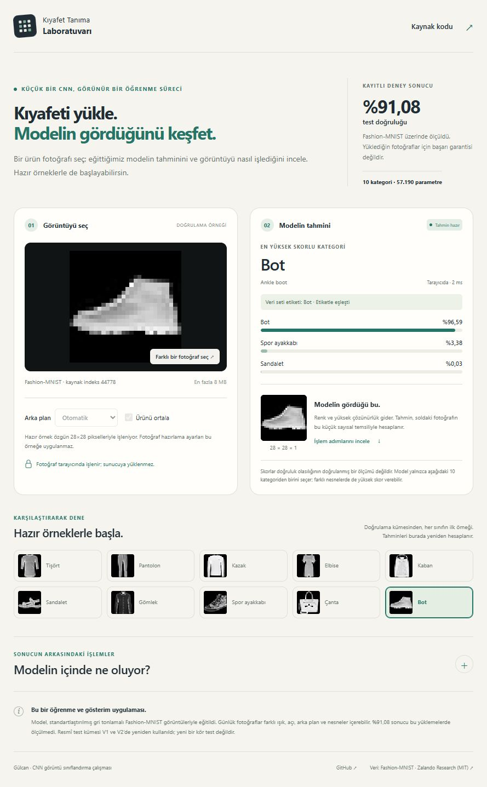
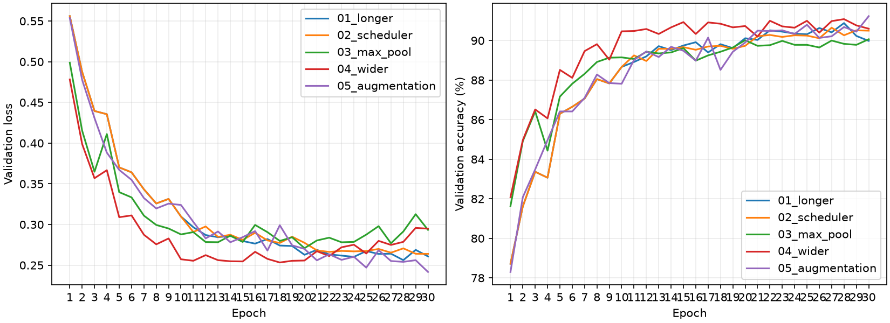
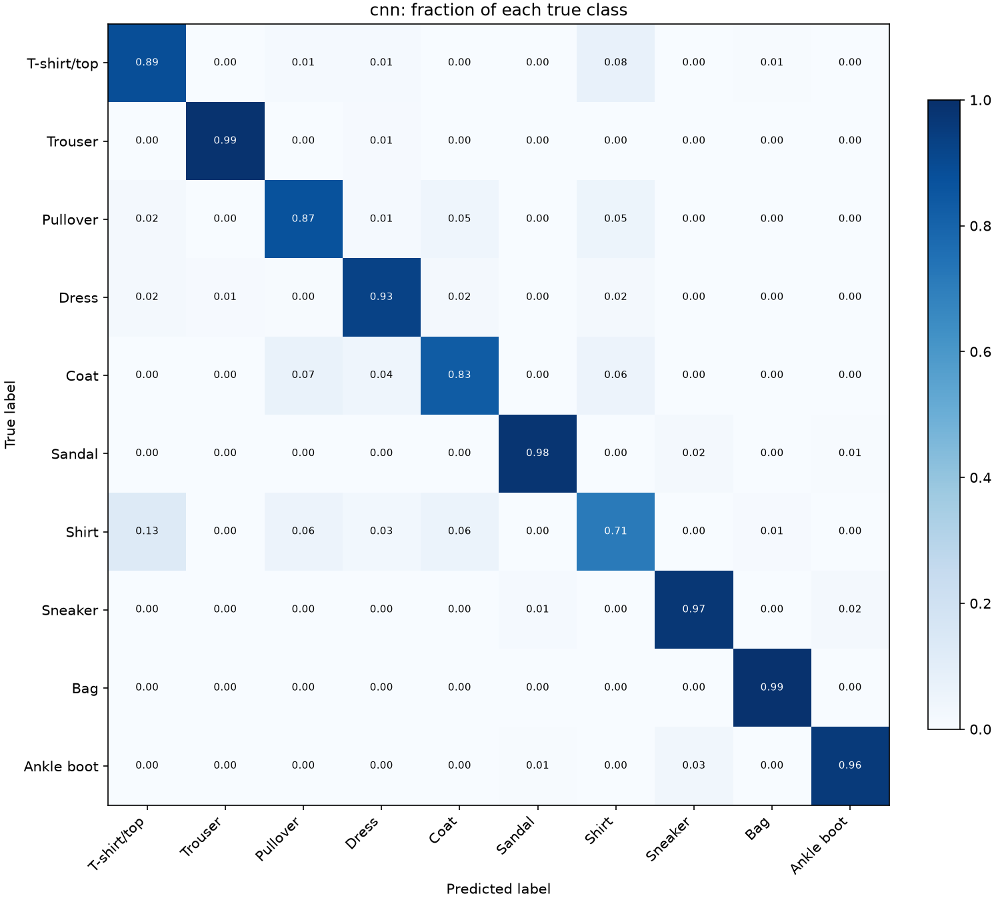

# Fashion-MNIST CNN: from local filters to error analysis

A small, LeNet-inspired image classification study built to understand convolution, learning and evaluation. It compares a linear classifier with two compact CNN versions, records a bounded improvement study, and inspects errors and intermediate activations.

**Selected V2 checkpoint: 91.08% test accuracy and 0.9101 macro-F1, using 57,190 parameters.** The official test set was reused after V1; this is not a new blind evaluation. V2 settings were selected using seed42 validation results. Across seeds 42/43/44, validation accuracy averaged **90.27%**, with a sample standard deviation of **0.844 percentage points** on one fixed split.

**[Open the live clothing-image demo](https://gulcan-cnn-kiyafet-laboratuvari.primegull512.chatgpt.site)** — upload a PNG/JPEG/WebP or select a dataset example. The actual exported CNN runs in the browser and shows the prepared28×28 input, top-three scores and intermediate feature maps. Photos are processed locally. Accuracy on arbitrary uploaded photographs has not been measured;91.08% is the recorded Fashion-MNIST benchmark result.

[Browser-demo implementation and validation notes](docs/WEB_DEMO_TR.md)

<details>
<summary>See the deployed demo</summary>



</details>


## What to read first

- [Walkthrough notebook](cnn_project.ipynb): executable explanations and recorded results; no training or test evaluation runs automatically.
- [Turkish engineering guide](docs/ENGINEERING_NOTES_TR.md): the reasoning behind the code, learning journal and glossary.
- [Model card](docs/MODEL_CARD.md): intended use, exact architecture, metrics and limitations.
- [Reproduction guide](docs/REPRODUCING.md): installation, saved-model inference and a full isolated rerun.
- [Code map](docs/CODE_MAP.md): where each part of the pipeline lives.
- [Publishing steps in Turkish](docs/PUBLISHING_TR.md): inspect the snapshot and publish it to your own repository.

## Results

All models use the same saved 54,000/6,000 training/validation split from the official 60,000 training images. The official test set has 10,000 images.

| Model | Parameters | Epoch budget | Validation accuracy | Test accuracy | Test macro-F1 | Test errors |
|---|---:|---:|---:|---:|---:|---:|
| Linear baseline | 7,850 | 10 | 85.52% | 84.55% | 0.8437 | 1,545 |
| V1 CNN | 25,010 | 10 | 88.67% | 88.12% | 0.8807 | 1,188 |
| Selected V2 CNN, seed42 | 57,190 | 30 | 91.23% | **91.08%** | **0.9101** | **892** |

V2 improved test accuracy by **2.96 percentage points** and reduced the number of errors by **296**, or **24.92%** relative to V1 CNN. Parameters, training budgets and selection rules differ; this table does not isolate the causal effect of convolution or augmentation.

### What changed during the improvement study?

Each candidate started from scratch. Each proposed change was applied to the settings of the best preceding candidate, using the same seed42 and 30-epoch budget. Candidates were selected by highest validation accuracy, then lowest loss on a tie. This is a five-candidate greedy search, not an exhaustive architecture search.

| Candidate | Actual settings | Selected epoch | Validation accuracy | Validation loss |
|---|---|---:|---:|---:|
| Longer training | 6/16 channels, average pooling | 28 | 90.88% | 0.2562 |
| Scheduler | 6/16, average pooling, StepLR | 27 | 90.65% | 0.2654 |
| Max pooling | 6/16, max pooling, no scheduler | 30 | 90.07% | 0.2933 |
| Wider | 16/32, average pooling, no scheduler | 28 | 91.08% | 0.2787 |
| Augmentation | Wider + padded random crop and horizontal flip | 30 | **91.23%** | **0.2416** |

The selected model uses **average pooling and no scheduler**. The largest observed gain came from longer training. Adding augmentation to the wider model gave only nine additional correct validation predictions in this seed; the two augmentation transforms were not isolated individually.



### Inspect both improvements and regressions

Paired predictions on the same test images show:

| Outcome | Images |
|---|---:|
| Both models correct | 8,546 |
| V1 wrong, V2 correct | 562 |
| V1 correct, V2 wrong | 266 |
| Both models wrong | 626 |

The net gain is `562 - 266 = 296`. Shirt remains difficult: recall is 71.2%, compared with 65.2% for V1. V2 misclassifies 132 Shirt images as T-shirt/top.



## Architecture and training

```text
1 x 28 x 28 grayscale image
 -> Conv2d(1, 16, 5) -> ReLU -> AvgPool2d(2)
 -> Conv2d(16, 32, 5) -> ReLU -> AvgPool2d(2)
 -> Flatten(512) -> Linear(512, 84) -> ReLU -> Linear(84, 10)
```

Two convolution layers and two linear layers; four learnable layers in total. Convolution stride is 1 with no padding; pooling stride is 2. The model emits logits, and CrossEntropyLoss receives those logits directly.

- Adam, learning rate 0.001, batch size 64, 30 epochs for V2.
- Training only: `RandomCrop(28, padding=2)`, `RandomHorizontalFlip(p=0.5)`, `ToTensor()`.
- Validation, test and inference: `ToTensor()` only, grayscale values scaled to [0,1].
- V1 selected the minimum validation loss; V2 selected maximum validation accuracy with loss as a tiebreaker.
- Fixed split seed42; saved split indices, histories, configs and checkpoints are included.

## Run a saved-model prediction

See [installation instructions](docs/REPRODUCING.md) first. Run commands from the repository root:

```powershell
python inspect_dataset.py
python predict.py --index 49804
```

The first command downloads Fashion-MNIST and makes the class overview. The second loads the selected checkpoint on CPU and prints its top three predictions for an official training-source image. Index 49804 belongs to the saved validation split. No training is required. Softmax scores are model outputs, not calibrated correctness guarantees.

## Reproduce without replacing the recorded study

```powershell
python reproduce.py --output runs/reproduction-01
```

This is a full training rerun, not a quick demo. It requires downloaded data, copies that data and the fixed split into a new directory, and runs V1, V2, the two extra seeds, evaluation and explanation. The destination must not exist. Original results remain intact. See [details and evaluation policy](docs/REPRODUCING.md).

## Reproducibility and limitations

- The measured environment was Windows 11 Pro, Ryzen 5 5600, 16 GB RAM, RTX 4060 8 GB, Python 3.14.7, PyTorch 2.14.1+cu130, torchvision 0.29.1+cu130, NumPy 2.5.2 and Matplotlib 3.11.2. Other hardware or versions may produce different results.
- Seeds 42/43/44 gave 91.23%, 89.65% and 89.93% validation accuracy. Seed42 was used to choose the settings and is therefore privileged in the selection process. The three-run mean is descriptive, not an unbiased estimate or confidence interval.
- Other configurations were not repeated across these extra seeds; a general augmentation advantage has not been established.
- The official test was evaluated for V1 and reused for V2. Test results were not used to choose V2 settings, but this is not an unseen independent holdout.
- Fashion-MNIST consists of small, standardized grayscale catalog images. Performance on arbitrary photographs, backgrounds or unseen categories has not been established.
- Activation maps show responses to an input; they do not establish the cause of a prediction. V2 initial filters were reconstructed from the same seed, factory and PyTorch version, not captured during training.
- This is a LeNet-inspired adaptation, **not an exact reproduction of LeNet-5**. An interactive browser demo is deployed; arbitrary-photo accuracy, production reliability and real-user traffic have not been established.

## Data, references and license

Fashion-MNIST is provided by Zalando Research under the [MIT license](https://github.com/zalandoresearch/fashion-mnist/blob/master/LICENSE). Raw data are downloaded through torchvision and are excluded from Git. Dataset-derived figures are attributed in [third-party notices](THIRD_PARTY_NOTICES.md); the upstream license notice is included. Project code is offered under the [MIT license](LICENSE).

- [LeCun et al., 1998 — Gradient-Based Learning Applied to Document Recognition](https://bottou.org/papers/lecun-98h)
- [Xiao et al., 2017 — Fashion-MNIST: a Novel Image Dataset for Benchmarking Machine Learning Algorithms](https://arxiv.org/abs/1708.07747)
- [Fashion-MNIST official repository](https://github.com/zalandoresearch/fashion-mnist)
- [PyTorch documentation](https://docs.pytorch.org/)

