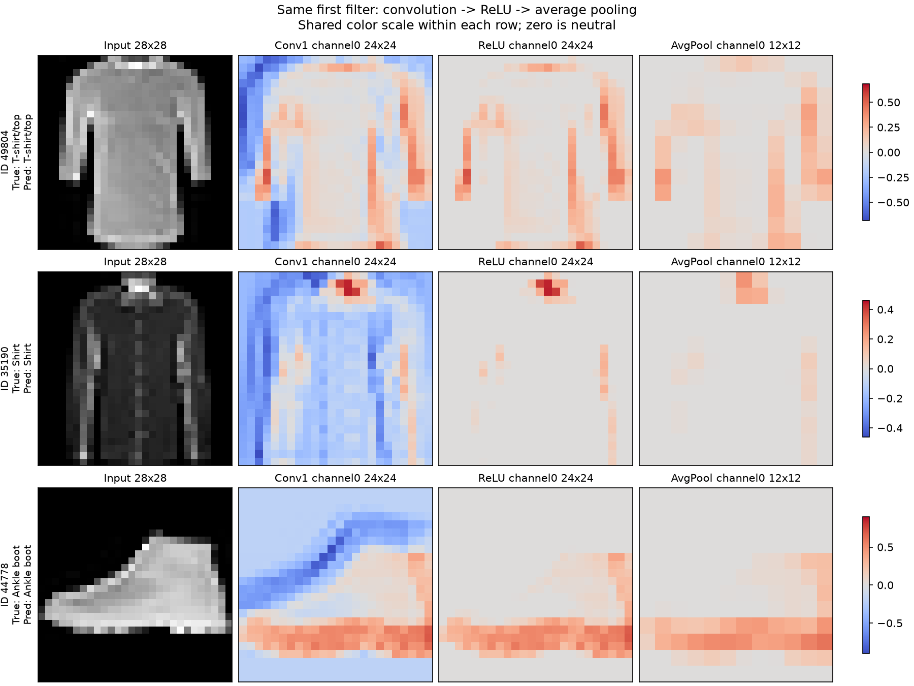

# Fashion-MNIST CNN study

[](https://github.com/gullcan/fashion-mnist-cnn-study/actions/workflows/checks.yml)

A small, LeNet-inspired study of how image classification works: pixels, learned filters, training, evaluation and mistakes. A linear baseline and two compact CNNs share a recorded 54,000/6,000 training/validation split.

**[Read the article (Turkish): Bir Bilgisayara Tişörtü Nasıl Anlatırsın?](https://medium.com/@dgulcan88/bir-bilgisayara-ti%C5%9F%C3%B6rt%C3%BC-nas%C4%B1l-anlat%C4%B1rs%C4%B1n-86493b8b5d4e)** — a beginner-friendly explanation of representation, learned filters, loss, generalization and the experiments behind this project.

**Selected CNN: 91.08% test accuracy, 0.9101 macro-F1, 57,190 parameters.** The official test set was reused after V1; this is not a new blind evaluation. This is an adaptation of LeNet ideas, not an exact LeNet-5 reproduction.

**[Try the live demo](https://gulcan-cnn-kiyafet-laboratuvari.primegull512.chatgpt.site)** — upload a photo or select a dataset example. The exported CNN runs in your browser and displays its actual 28×28 input, class scores and feature maps. Arbitrary-photo accuracy has not been measured.



## Results

| Model | Parameters | Epoch budget | Validation accuracy | Test accuracy | Test macro-F1 |
|---|---:|---:|---:|---:|---:|
| Linear baseline | 7,850 | 10 | 85.52% | 84.55% | 0.8437 |
| V1 CNN | 25,010 | 10 | 88.67% | 88.12% | 0.8807 |
| Selected V2 CNN, seed42 | 57,190 | 30 | 91.23% | **91.08%** | **0.9101** |

V2 made 892 test errors, 296 fewer than V1. Paired predictions include 562 corrected and 266 newly incorrect examples. The model still struggles with similar garment categories. Different training budgets and parameter counts prevent attributing the entire gain to one architectural change.

Settings were selected through five bounded validation experiments. The final recipe uses 16/32 channels, **average pooling**, Adam (0.001), batch size 64 and training-only crop/flip augmentation. Across seeds 42/43/44, validation accuracy averaged **90.27% ± 0.844 percentage points** (sample standard deviation, one fixed split). Seed42 was used for selection; this is a descriptive check, not an unbiased estimate.

## Start here

Use Python 3.14 to match the measured environment. From the repository root, create and activate a virtual environment, then install a suitable PyTorch build and the project:

```powershell
py -3.14 -m venv .venv
.\.venv\Scripts\Activate.ps1
python -m pip install torch==2.14.1 torchvision==0.29.1 --index-url https://download.pytorch.org/whl/cpu
python -m pip install -e .
python -m fashion_cnn verify
python -m fashion_cnn download
python -m fashion_cnn predict --index 49804
```

CPU inference is sufficient. For NVIDIA training, see the [installation and reproduction guide](docs/REPRODUCING.md). Dependencies are defined once in `pyproject.toml`. The installed `fashion-cnn` command is equivalent to `python -m fashion_cnn`.

Train the selected recipe from fresh weights, or check the saved model on validation data:

```powershell
python -m fashion_cnn train --epochs 30 --output runs/my-training
python -m fashion_cnn evaluate --output runs/my-validation
python -m fashion_cnn explain --output runs/my-explanation
```

Output directories must be new. New runs do not replace the evidence in `results/`. Evaluation uses validation data by default; accessing the official test requires an explicit `--test`. The full historical campaign is a separate 230-epoch operation described in the reproduction guide.

## Structure

```text
fashion_cnn/       model, data, training, metrics, inference and command interface
  experiments/    original study protocols and report orchestration
lessons/          preserved, runnable learning exercises
tests/            core contracts and regression checks
web/              browser demo source, exported weights and independent checks
results/          original measured evidence and selected checkpoints
docs/             architecture, model card and explanations
cnn_project.ipynb  executable reading guide; no automatic training/test evaluation
```

The model is defined once. Prediction imports neither experiment orchestration nor plotting. [Read the code map](docs/CODE_MAP.md) for the dependency direction and implementation locations.

## Checks

```powershell
python -m unittest discover -s tests -v
python -m fashion_cnn verify
node web/tests/test-runtime.mjs
node web/tests/test-preprocess.mjs
```

Python tests cover split integrity, metrics, gradient/update boundaries, final short batches and checkpoint compatibility. Browser checks compare 100 fixed validation inputs with independent PyTorch references and exercise preprocessing. Matching predictions across implementations is not 100% classification accuracy. GitHub Actions runs these checks without downloading the dataset or training the full study. See [verification scope](docs/VERIFICATION.md).

## Read further

- [Turkish engineering guide and glossary](docs/ENGINEERING_NOTES_TR.md)
- [Model card: architecture, experiments and limitations](docs/MODEL_CARD.md)
- [Reproduce the study](docs/REPRODUCING.md)
- [Browser demo: source, preprocessing and limitations](docs/WEB_DEMO_TR.md)
- [Walkthrough notebook](cnn_project.ipynb)

Measured environment: Windows 11 Pro, Ryzen 5 5600, 16 GB RAM, RTX 4060 8 GB; Python 3.14.7, PyTorch 2.14.1+cu130 and torchvision 0.29.1+cu130. Seeds do not guarantee identical results across hardware or builds. Feature maps show responses, not causal explanations. Softmax scores are not calibrated correctness probabilities.

## References and license

- [LeCun et al. (1998), Gradient-Based Learning Applied to Document Recognition](https://bottou.org/papers/lecun-98h)
- [Xiao et al. (2017), Fashion-MNIST](https://arxiv.org/abs/1708.07747)
- [Fashion-MNIST official repository](https://github.com/zalandoresearch/fashion-mnist)

Project code is [MIT licensed](LICENSE). Dataset-derived figures/examples are attributed in [third-party notices](THIRD_PARTY_NOTICES.md), including the upstream MIT notice. Raw data are downloaded through torchvision and excluded from Git.
